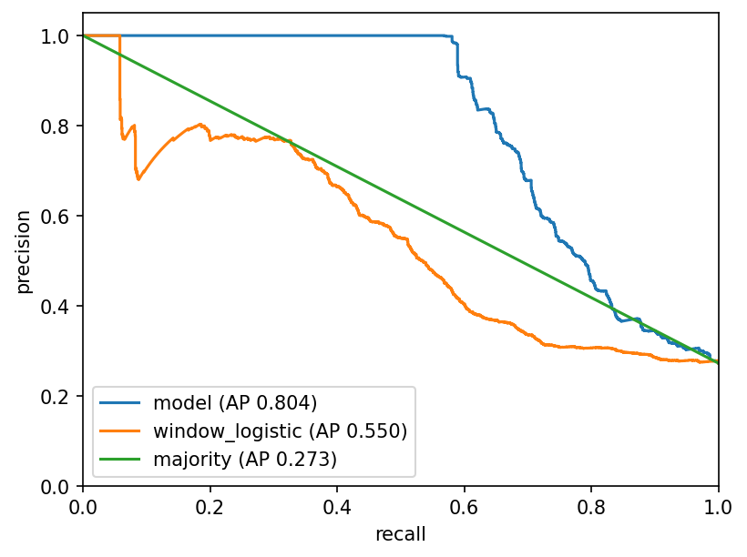
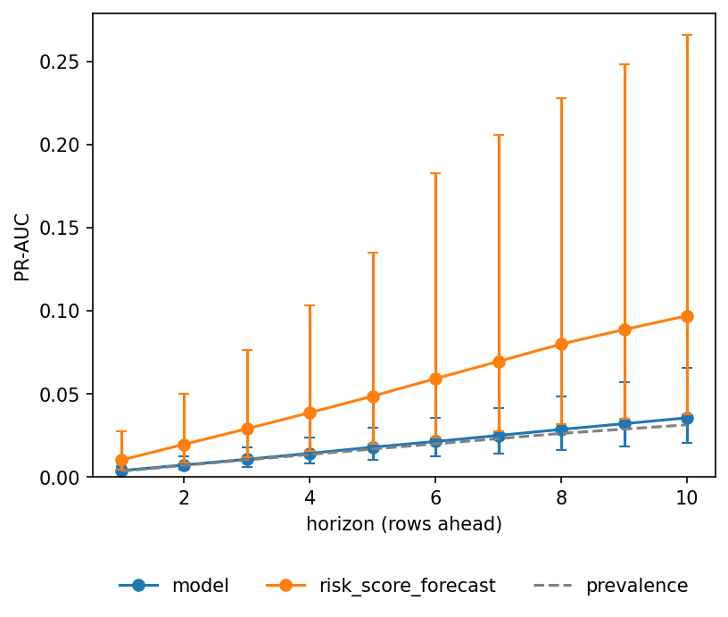
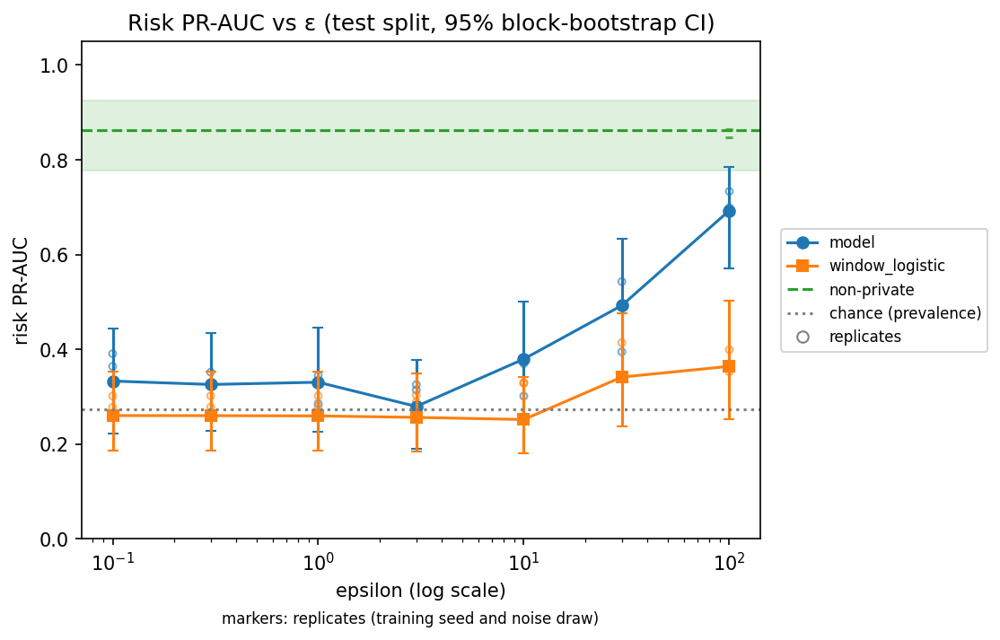

# Dignity Core: Sequence Models for Transaction Risk

[](https://github.com/crichalchemist/Dignity/actions/workflows/ci.yml)
[](https://python.org/)
[](LICENSE)

Detect, warn early, decide: three heads on one CNN-LSTM-attention backbone score transaction risk on synthetic data, each against the baseline it has to beat.

## What it does

- **Detect**: is an anomaly active in this window? The `risk` head, scored by PR-AUC against `window_logistic` and `block_tree`.
- **Warn early**: will an anomaly start within the next 1 to `model.horizon` rows? The forecast head, scored by PR-AUC per horizon and by lead time against `risk_score_forecast`.
- **Decide**: allow, review or block each window under a 5% review budget (`policy.review_budget`). The policy head, scored by expected cost against `threshold_policy`.

It scores risk and gives no advice on what to transact.

## Results

**Verdict.** Risk clears both baselines; forecast and triage do not clear theirs; the privacy curve is at chance at every grid value except those it lists: above chance at ε 0.1 <!--num privacy.json metrics.points.0.epsilon g-->, ε 0.3 <!--num privacy.json metrics.points.1.epsilon g-->, ε 3 <!--num privacy.json metrics.points.3.epsilon g-->, ε 10 <!--num privacy.json metrics.points.4.epsilon g-->, ε 30 <!--num privacy.json metrics.points.5.epsilon g-->, ε 100 <!--num privacy.json metrics.points.6.epsilon g-->.

**Outcome.** On risk, the window gate passes against `window_logistic` and the block gate passes against `block_tree`. On forecast, the model's PR-AUC interval clears `risk_score_forecast` at no horizon, its point estimate is below the baseline's at every horizon, the model's PR-AUC interval contains the prevalence at every horizon, the baseline's PR-AUC interval lies wholly above the prevalence at every horizon, the baseline's lower bound is above the model's point estimate at every horizon, and the model warns ahead of no onset. On policy, the triage head's expected cost is higher than the threshold policy's, so the triage head does not beat the threshold policy.

The numbers of the four `eval.run` results are evaluation-seed scores. They are for the `hard` preset (`config/synthetic_hard.yaml`). The headline training seed is the first of three training seeds. Intervals are 95% bootstrap intervals over test blocks. `pr_auc_by_horizon.N` scores an onset within the next N plus one rows; chance is the prevalence. Which seed produced them, and what that implies, is in the Seeds bullet of the [protocol](docs/RESULTS.md#protocol). Commands, baselines and caveats are in [docs/RESULTS.md](docs/RESULTS.md); recall per anomaly type is in its [per-type results](docs/RESULTS.md#per-type-results).

<!--results-start-->
| Metric | Model | Baseline | File |
|---|---|---|---|
| `auroc` | 0.82 <!--num risk.json metrics.auroc.value .2f--> | `window_logistic` 0.77 <!--num risk.json baselines.window_logistic.auroc.value .2f--> | `results/v1.0/risk.json` |
| `pr_auc` | 0.79 <!--num risk.json metrics.pr_auc.value .2f--> [0.69 <!--num risk.json metrics.pr_auc.ci_low .2f-->, 0.87 <!--num risk.json metrics.pr_auc.ci_high .2f-->] | `window_logistic` 0.56 <!--num risk.json baselines.window_logistic.pr_auc.value .2f--> | `results/v1.0/risk.json` |
| `recall_at_1pct_fpr` | 0.53 <!--num risk.json metrics.recall_at_1pct_fpr.value .2f--> | `window_logistic` 0.11 <!--num risk.json baselines.window_logistic.recall_at_1pct_fpr.value .2f--> | `results/v1.0/risk.json` |
| `pr_auc` per block | 0.84 <!--num risk.json metrics.block_level.pr_auc.value .2f--> | `block_tree` 0.34 <!--num risk.json baselines.block_tree.pr_auc.value .2f--> | `results/v1.0/risk.json` |
| `pr_auc_by_horizon.4` (five rows ahead; chance 0.0169 <!--num forecast.json metrics.prevalence_by_horizon.4 .4f-->) | 0.0180 <!--num forecast.json metrics.pr_auc_by_horizon.4.value .4f--> [0.0105 <!--num forecast.json metrics.pr_auc_by_horizon.4.ci_low .4f-->, 0.0297 <!--num forecast.json metrics.pr_auc_by_horizon.4.ci_high .4f-->] | `risk_score_forecast` 0.0487 <!--num forecast.json baselines.risk_score_forecast.pr_auc_by_horizon.4.value .4f--> | `results/v1.0/forecast.json` |
| `lead_time.median` | n/a <!--num forecast.json metrics.lead_time.median .1f--> | `risk_score_forecast` 8.5 <!--num forecast.json baselines.risk_score_forecast.lead_time.median .1f--> | `results/v1.0/forecast.json` |
| `lead_time.n_missed` | 26 <!--num forecast.json metrics.lead_time.n_missed d--> | `risk_score_forecast` 24 <!--num forecast.json baselines.risk_score_forecast.lead_time.n_missed d--> | `results/v1.0/forecast.json` |
| `lead_time.n_onsets` | 26 <!--num forecast.json metrics.lead_time.n_onsets d--> | `risk_score_forecast` 26 <!--num forecast.json baselines.risk_score_forecast.lead_time.n_onsets d--> | `results/v1.0/forecast.json` |
| `expected_cost` | 2.31 <!--num policy.json metrics.expected_cost.value .2f--> [1.69 <!--num policy.json metrics.expected_cost.ci_low .2f-->, 2.94 <!--num policy.json metrics.expected_cost.ci_high .2f-->] | `threshold_policy` 1.09 <!--num policy.json baselines.threshold_policy.expected_cost.value .2f--> [0.73 <!--num policy.json baselines.threshold_policy.expected_cost.ci_low .2f-->, 1.45 <!--num policy.json baselines.threshold_policy.expected_cost.ci_high .2f-->] | `results/v1.0/policy.json` |
| `pr_auc` without privacy (non-private, privacy feature set, not the headline model) | 0.86 <!--num privacy.json metrics.reference.risk.pr_auc.value .2f--> [0.78 <!--num privacy.json metrics.reference.risk.pr_auc.ci_low .2f-->, 0.92 <!--num privacy.json metrics.reference.risk.pr_auc.ci_high .2f-->] | `window_logistic` 0.54 <!--num privacy.json baselines.window_logistic.reference.pr_auc.value .2f--> | `results/v1.0/privacy.json` |
| `pr_auc` at ε 0.1 <!--num privacy.json metrics.points.0.epsilon g--> | 0.45 <!--num privacy.json metrics.points.0.risk.pr_auc.value .2f--> [0.30 <!--num privacy.json metrics.points.0.risk.pr_auc.ci_low .2f-->, 0.58 <!--num privacy.json metrics.points.0.risk.pr_auc.ci_high .2f-->] | `window_logistic` 0.38 <!--num privacy.json baselines.window_logistic.points.0.pr_auc.value .2f--> | `results/v1.0/privacy.json` |
| `pr_auc` at ε 100 <!--num privacy.json metrics.points.6.epsilon g--> | 0.79 <!--num privacy.json metrics.points.6.risk.pr_auc.value .2f--> [0.69 <!--num privacy.json metrics.points.6.risk.pr_auc.ci_low .2f-->, 0.86 <!--num privacy.json metrics.points.6.risk.pr_auc.ci_high .2f-->] | `window_logistic` 0.42 <!--num privacy.json baselines.window_logistic.points.6.pr_auc.value .2f--> | `results/v1.0/privacy.json` |
<!--results-end-->





The privacy baseline is `window_logistic` on the released windows. The reference row is a non-private model on the privacy feature set, not the headline model; the prevalence, the chance line, is 0.26 <!--num privacy.json metrics.reference.risk.prevalence.value .2f-->. The shipped config is not a point on this curve: its ε of 1.0 is a grid value, but the curve runs on the hard preset with that preset's training settings.

## Quickstart

Python 3.10 to 3.12 (CI runs Linux with 3.10 and 3.12; `numpy<2` caps the range). From a fresh clone:

```bash
python3 -m venv .venv && source .venv/bin/activate
pip install torch --index-url https://download.pytorch.org/whl/cpu
pip install -r requirements.txt -r requirements-dev.txt
pip install -e . --no-deps
```

On Intel macOS PyPI has no torch 2.5 or newer wheel, and a venv cannot see a conda-installed PyTorch, so use a conda environment instead of the block above, as the project's macOS checkout does (pip counts conda's PyTorch as satisfying `torch>=2.5.0`):

```bash
conda create -n dignity -c conda-forge python=3.11 "pytorch>=2.5"
conda activate dignity
pip install -r requirements.txt -r requirements-dev.txt
pip install -e . --no-deps
```

Then:

```bash quickstart
python -m train.cli --config config/smoke.yaml
python -m export.to_onnx --checkpoint runs/smoke/train/best.pt --output dignity_risk.onnx
python -m eval.run --config config/smoke.yaml --seed tuning
```

They train a risk model into `runs/smoke/train`, export and verify `dignity_risk.onnx`, and write results to `runs/smoke/results` and charts to `runs/smoke/img`. The full evaluation, and any config that keeps the default `eval.out_dir` and `eval.img_dir`, writes `results/v1.0` and `docs/img` (see the [Colab runbook](docs/RESULTS.md#colab-runbook)). See [docs/ARCHITECTURE.md](docs/ARCHITECTURE.md).

Tests: `pytest tests/ -m "not slow"` is the fast run; `pytest tests/` is the full run, which also executes the quickstart above.

## How this was built

Agent workflow rules live in `.claude/CLAUDE.md`. An adversarial review found that the original benchmark was trivially easy: a depth-3 tree on per-block statistics separated every block (DGNTY-10). The generator was rebuilt with difficulty presets; the final evaluation ran on the evaluation seed. Each finding became an issue (DGNTY ids are rows of [docs/HOW-IT-WAS-BUILT.md](docs/HOW-IT-WAS-BUILT.md); the tracker is private), and each fix went to a PR and a CI run; that page records the status of every one, and DGNTY-8, DGNTY-27 and DGNTY-40 are still open (see its Status column).

## Limitations

- Synthetic data only: `data.source` accepts only `synthetic`, and there is no result on real data.
- `fee_rate` and `tx_count` are uncalibrated.
- The triage costs (`policy.costs`) are a stated assumption in the config.
- The block baseline `block_tree` is close to chance on the evaluation seed (AUROC per block 0.53 <!--num risk.json baselines.block_tree.auroc.value .2f-->), so the block gate is weaker evidence than the window gate.
- Privacy: On the evaluation seed, the shipped allocation leaves the risk model's PR-AUC not distinguishable from chance on the hard preset at ε 1, and above chance at ε 0.1, 0.3, 3, 10, 30 and 100 ([curve](docs/PRIVACY.md#privacy-versus-utility-curve)), although inputs can be made differentially private (ε is the per-released-value Laplace budget on `volume`; `fee_rate` and `tx_count` are released by k-anonymous generalization, which ε does not govern; `price` is not consumed; the shipped config is not a point on the curve; see the [threat model](docs/THREAT-MODEL.md)). The intervals are one noise draw and one training seed, ε 30 and ε 100 are not offered as private settings, and k-anonymity holds for the train release only. AUROC does not confirm the PR-AUC result at ε 0.1, 0.3 and 3, and the private model clears `window_logistic` only at ε 100. There is no inference-time privacy release path (DGNTY-27).

## Roadmap

Planned for v1.1, none of it in v1.0:

- Planned: fix the real-data source `CryptoSource` (DGNTY-7, DGNTY-13, DGNTY-14, DGNTY-15).
- Planned: a dataset adapter layer that dispatches on `data.source` (DGNTY-41).
- Planned: a labelled manipulation-event dataset, the public pump-and-dump events (La Morgia et al., 2020), as the first real-data result (DGNTY-42).
- Planned: per-block aggregates from a public chain dataset (DGNTY-44).
- Planned, not yet tracked: per-entity amount features for structuring typologies.
