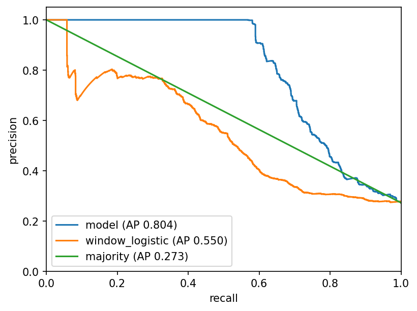
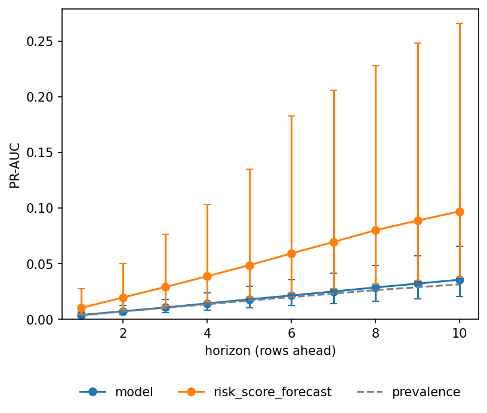
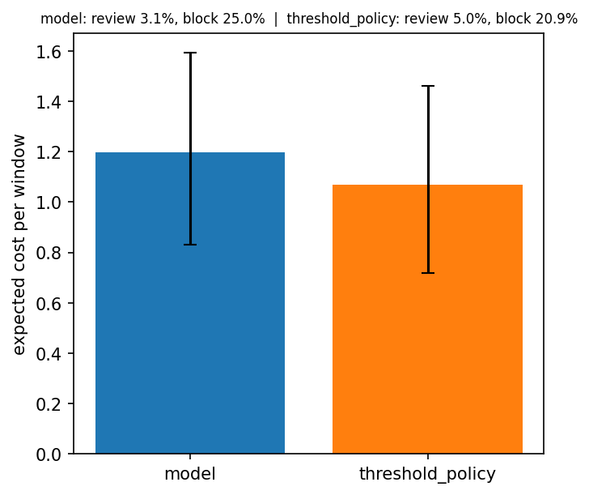
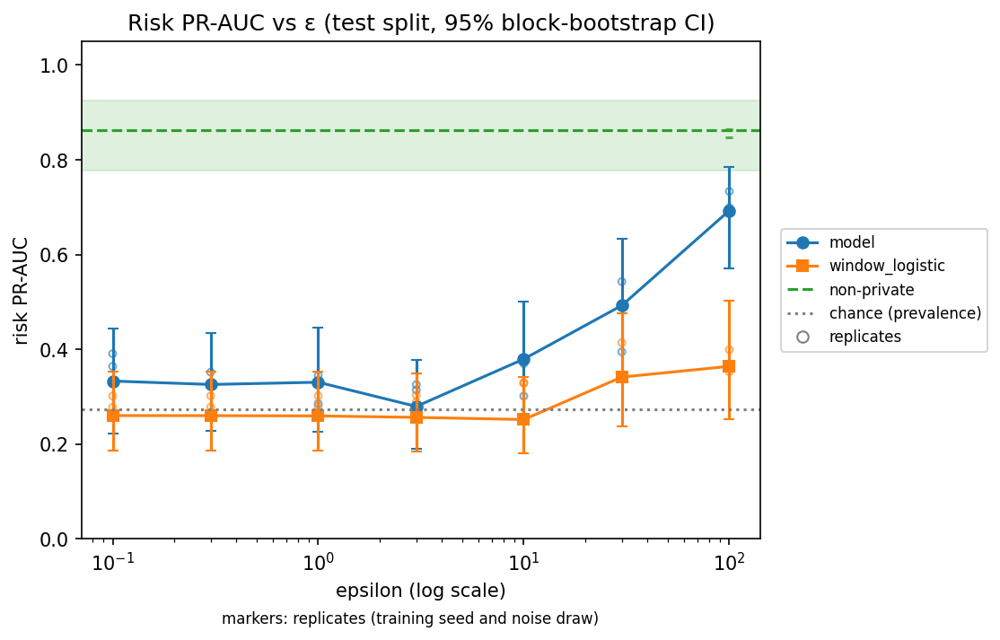
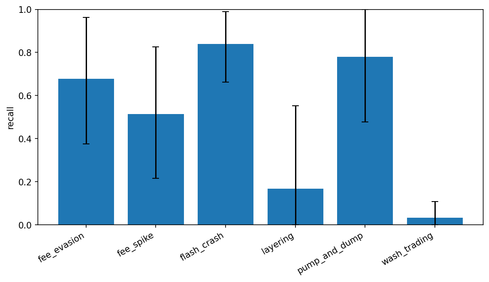

# Results

<!--provisional-->**Provisional: numbers are from the tuning seed; the final evaluation has not run.**

**Outcome.** These are the outcomes for the headline training seed. On risk, the window gate passes against `window_logistic` and the block gate passes against `block_tree`. On forecast, the model's PR-AUC interval clears `risk_score_forecast` at no horizon, its point estimate is below the baseline's at every horizon, the model's PR-AUC interval contains the prevalence at every horizon (the prevalence is the chance line of PR-AUC), the baseline's PR-AUC interval lies wholly above the prevalence at every horizon, the baseline's lower bound is above the model's point estimate at most horizons (more than half of them, not all), and the model warns ahead of no onset. On policy, the triage head's expected cost is higher than the threshold policy's, so the triage head does not beat the threshold policy. On the privacy curve, the risk model's PR-AUC is not distinguishable from chance at every grid value except the two largest, where it is above chance.

This file reports what the three tasks score on the `hard` synthetic preset, next to the baselines each one has to beat. Every result number is written through a marker and filled from `results/v1.0/risk.json`, `results/v1.0/forecast.json`, `results/v1.0/policy.json`, `results/v1.0/privacy.json` (the four `eval.run` results) or `results/v1.0/data_gate_tuning.json`; `scripts/refresh_doc_numbers.py` rewrites them, and `tests/test_docs.py` fails when a token differs from its file. The sentences that state an outcome are checked against the same files, so a test fails when the numbers change and a sentence does not.

The numbers below come from seed 1000 <!--num risk.json seed d-->, one run of the command in each Source cell. The data-gate numbers in the Protocol are the exception: `eval.gates` wrote them, with its own command (see [Reproduce](#reproduce)).

## Protocol

- **Tasks.** Risk scores a window for an anomaly (`risk` head). Forecast is early warning: will an anomaly begin within the next rows, up to `model.horizon` of them. Policy is triage: allow, review or block a window under a review budget. All three are risk tasks on the same synthetic event record (`data.source` is `synthetic` in v1.0).
- **Split.** A block-level 70/15/15 split (`data.split`): every block lies wholly in one of train, validation and test, so no window crosses two splits.
- **Presets.** The headline models are trained, validated and tested on the `hard` preset (`config/synthetic_hard.yaml`). The `easy` and `medium` presets (`config/synthetic_easy.yaml`, `config/synthetic_medium.yaml`) are used only for the baseline difficulty curve of the data gate (`eval/gates.py::data_gate`), which scores `window_logistic` and `block_tree` on each preset's validation split. Its output is `results/v1.0/data_gate_tuning.json`: validation scores that `eval.gates` writes, always on the tuning seed 1000 <!--num data_gate_tuning.json seed d-->: the AUROC of `window_logistic` falls from 0.81 <!--num data_gate_tuning.json auroc.easy.window_logistic .2f--> on easy through 0.76 <!--num data_gate_tuning.json auroc.medium.window_logistic .2f--> on medium to 0.74 <!--num data_gate_tuning.json auroc.hard.window_logistic .2f--> on hard, and that of `block_tree` from 0.74 <!--num data_gate_tuning.json auroc.easy.block_tree .2f--> through 0.65 <!--num data_gate_tuning.json auroc.medium.block_tree .2f--> to 0.60 <!--num data_gate_tuning.json auroc.hard.block_tree .2f-->.
- **Seeds.** Two data seeds are frozen: the tuning seed (`eval.tuning_seed`) and the evaluation seed (`core.config.EvalConfig.eval_seed`, `2026`). The freeze is a standing commitment and a procedure: the final run is made from a commit tagged `v1.0-freeze`, the generator presets and the evaluation seed do not change after that tag is created, and the model and the presets are not re-tuned against the evaluation seed's test split. The numbers of the four `eval.run` results (`results/v1.0/risk.json`, `results/v1.0/forecast.json`, `results/v1.0/policy.json` and `results/v1.0/privacy.json`) are tuning-seed test scores, and the tuning seed's test split was read during development, so they are not an unbiased estimate of the final evaluation, which replaces them.
- **Intervals.** Confidence intervals are 95% bootstrap intervals over blocks, not windows (`eval/metrics.py::bootstrap_ci`, `eval.n_bootstrap` resamples). They resample test blocks only and do not include the variation between training seeds.
- **Training seeds.** `eval.n_train_seeds` models are trained per task. The headline model is the first training seed, declared in advance, and every interval is for it; `metrics.seed_spread` in the risk, forecast and policy files reports the spread over all of them, and the mean and standard deviation are quoted under the risk, forecast and policy tables. The standard deviation is the sample standard deviation, not the population one, and it is n/a when fewer than two seeds have a value (`eval/run.py::_spread`).
- **Selection.** `best.pt` is kept on validation PR-AUC for risk and forecast (`train.select_metric`; for forecast the mean over the horizons whose column holds both classes) and, for policy, on validation `neg_cost` under the review cap. The test split takes no part in selection.
- **Warm start.** The policy head starts from the backbone of the same training seed's risk checkpoint (`train.init_backbone_from`, `train/loop.py::load_backbone`).
- **Policy tuning.** The two thresholds of the `threshold_policy` baseline are tuned on the validation split only, under `policy.review_budget`, then applied to test. The triage head has no tuned thresholds: its validation role is the `neg_cost` selection above.
- **Early warning.** A forecast window whose last row lies inside an active anomaly is left out of the loss, the metrics and the lead times. The alarm threshold of the lead time is the 1% false-positive point of the last-horizon column on validation, and an alarm fires at or above it.

## Baselines

- `majority`: the train prevalence as a constant score (`eval/baselines.py::majority`).
- `window_logistic` on the raw columns: a standardized logistic regression on the maximum, minimum and standard deviation over time of `volume`, `price`, `fee_rate` and `tx_count` in each window (`eval/baselines.py::window_logistic`). The risk table uses it.
- `window_logistic` on the released windows: the same model fitted on the windows of the privacy-stage release at each ε. The privacy table uses it, so its numbers are not those of the risk table's `window_logistic`.
- `block_tree`: a depth-3 decision tree on the mean, standard deviation and maximum of the raw columns per block, trained on the noisy `block_label` and scored against whether the block holds an anomaly (`eval/baselines.py::block_tree`).
- `risk_score_forecast`: today's risk score used as the score at every horizon (`eval/baselines.py::risk_score_forecast`).
- `threshold_policy`: two thresholds on the risk score, tuned on validation under the review budget, with reviews beyond capacity keeping only the highest scores (`eval/baselines.py::threshold_policy`).

The risk table pairs window rows with `window_logistic` and block rows with `block_tree`.

## Risk

Window rows are scored on every test window; block rows score a block by its highest window score. `recall_at_1pct_fpr` is the recall at a 1% false-positive rate, and `prevalence` is the share of positive windows or blocks, the chance line of PR-AUC.

<!--results-start-->
| Metric | Model | Baseline | Source |
|---|---|---|---|
| `auroc` | 0.84 <!--num risk.json metrics.auroc.value .2f--> [0.76 <!--num risk.json metrics.auroc.ci_low .2f-->, 0.90 <!--num risk.json metrics.auroc.ci_high .2f-->] | `window_logistic` 0.68 <!--num risk.json baselines.window_logistic.auroc.value .2f--> [0.59 <!--num risk.json baselines.window_logistic.auroc.ci_low .2f-->, 0.77 <!--num risk.json baselines.window_logistic.auroc.ci_high .2f-->] | `python -m eval.run --config config/synthetic_hard.yaml --seed tuning --tasks risk,forecast,policy --privacy-sweep` -> `results/v1.0/risk.json` |
| `pr_auc` | 0.81 <!--num risk.json metrics.pr_auc.value .2f--> [0.72 <!--num risk.json metrics.pr_auc.ci_low .2f-->, 0.88 <!--num risk.json metrics.pr_auc.ci_high .2f-->] | `window_logistic` 0.55 <!--num risk.json baselines.window_logistic.pr_auc.value .2f--> [0.41 <!--num risk.json baselines.window_logistic.pr_auc.ci_low .2f-->, 0.68 <!--num risk.json baselines.window_logistic.pr_auc.ci_high .2f-->] | `python -m eval.run --config config/synthetic_hard.yaml --seed tuning --tasks risk,forecast,policy --privacy-sweep` -> `results/v1.0/risk.json` |
| `brier` | 0.10 <!--num risk.json metrics.brier.value .2f--> [0.07 <!--num risk.json metrics.brier.ci_low .2f-->, 0.14 <!--num risk.json metrics.brier.ci_high .2f-->] | `window_logistic` 0.17 <!--num risk.json baselines.window_logistic.brier.value .2f--> [0.13 <!--num risk.json baselines.window_logistic.brier.ci_low .2f-->, 0.21 <!--num risk.json baselines.window_logistic.brier.ci_high .2f-->] | `python -m eval.run --config config/synthetic_hard.yaml --seed tuning --tasks risk,forecast,policy --privacy-sweep` -> `results/v1.0/risk.json` |
| `prevalence` | 0.27 <!--num risk.json metrics.prevalence.value .2f--> [0.20 <!--num risk.json metrics.prevalence.ci_low .2f-->, 0.34 <!--num risk.json metrics.prevalence.ci_high .2f-->] | `window_logistic` 0.27 <!--num risk.json baselines.window_logistic.prevalence.value .2f--> [0.20 <!--num risk.json baselines.window_logistic.prevalence.ci_low .2f-->, 0.34 <!--num risk.json baselines.window_logistic.prevalence.ci_high .2f-->] | `python -m eval.run --config config/synthetic_hard.yaml --seed tuning --tasks risk,forecast,policy --privacy-sweep` -> `results/v1.0/risk.json` |
| `recall_at_1pct_fpr` | 0.59 <!--num risk.json metrics.recall_at_1pct_fpr.value .2f--> [0.48 <!--num risk.json metrics.recall_at_1pct_fpr.ci_low .2f-->, 0.73 <!--num risk.json metrics.recall_at_1pct_fpr.ci_high .2f-->] | `window_logistic` 0.08 <!--num risk.json baselines.window_logistic.recall_at_1pct_fpr.value .2f--> [0.02 <!--num risk.json baselines.window_logistic.recall_at_1pct_fpr.ci_low .2f-->, 0.32 <!--num risk.json baselines.window_logistic.recall_at_1pct_fpr.ci_high .2f-->] | `python -m eval.run --config config/synthetic_hard.yaml --seed tuning --tasks risk,forecast,policy --privacy-sweep` -> `results/v1.0/risk.json` |
| `auroc` per block | 0.88 <!--num risk.json metrics.block_level.auroc.value .2f--> [0.80 <!--num risk.json metrics.block_level.auroc.ci_low .2f-->, 0.94 <!--num risk.json metrics.block_level.auroc.ci_high .2f-->] | `block_tree` 0.61 <!--num risk.json baselines.block_tree.auroc.value .2f--> [0.53 <!--num risk.json baselines.block_tree.auroc.ci_low .2f-->, 0.69 <!--num risk.json baselines.block_tree.auroc.ci_high .2f-->] | `python -m eval.run --config config/synthetic_hard.yaml --seed tuning --tasks risk,forecast,policy --privacy-sweep` -> `results/v1.0/risk.json` |
| `pr_auc` per block | 0.87 <!--num risk.json metrics.block_level.pr_auc.value .2f--> [0.79 <!--num risk.json metrics.block_level.pr_auc.ci_low .2f-->, 0.94 <!--num risk.json metrics.block_level.pr_auc.ci_high .2f-->] | `block_tree` 0.45 <!--num risk.json baselines.block_tree.pr_auc.value .2f--> [0.34 <!--num risk.json baselines.block_tree.pr_auc.ci_low .2f-->, 0.57 <!--num risk.json baselines.block_tree.pr_auc.ci_high .2f-->] | `python -m eval.run --config config/synthetic_hard.yaml --seed tuning --tasks risk,forecast,policy --privacy-sweep` -> `results/v1.0/risk.json` |
| `brier` per block | 0.12 <!--num risk.json metrics.block_level.brier.value .2f--> [0.08 <!--num risk.json metrics.block_level.brier.ci_low .2f-->, 0.16 <!--num risk.json metrics.block_level.brier.ci_high .2f-->] | `block_tree` 0.20 <!--num risk.json baselines.block_tree.brier.value .2f--> [0.16 <!--num risk.json baselines.block_tree.brier.ci_low .2f-->, 0.24 <!--num risk.json baselines.block_tree.brier.ci_high .2f-->] | `python -m eval.run --config config/synthetic_hard.yaml --seed tuning --tasks risk,forecast,policy --privacy-sweep` -> `results/v1.0/risk.json` |
| `prevalence` per block | 0.31 <!--num risk.json metrics.block_level.prevalence.value .2f--> [0.24 <!--num risk.json metrics.block_level.prevalence.ci_low .2f-->, 0.39 <!--num risk.json metrics.block_level.prevalence.ci_high .2f-->] | `block_tree` 0.31 <!--num risk.json baselines.block_tree.prevalence.value .2f--> [0.24 <!--num risk.json baselines.block_tree.prevalence.ci_low .2f-->, 0.39 <!--num risk.json baselines.block_tree.prevalence.ci_high .2f-->] | `python -m eval.run --config config/synthetic_hard.yaml --seed tuning --tasks risk,forecast,policy --privacy-sweep` -> `results/v1.0/risk.json` |
| `recall_at_1pct_fpr` per block | 0.68 <!--num risk.json metrics.block_level.recall_at_1pct_fpr.value .2f--> [0.55 <!--num risk.json metrics.block_level.recall_at_1pct_fpr.ci_low .2f-->, 0.82 <!--num risk.json metrics.block_level.recall_at_1pct_fpr.ci_high .2f-->] | `block_tree` 0.17 <!--num risk.json baselines.block_tree.recall_at_1pct_fpr.value .2f--> [0.00 <!--num risk.json baselines.block_tree.recall_at_1pct_fpr.ci_low .2f-->, 0.28 <!--num risk.json baselines.block_tree.recall_at_1pct_fpr.ci_high .2f-->] | `python -m eval.run --config config/synthetic_hard.yaml --seed tuning --tasks risk,forecast,policy --privacy-sweep` -> `results/v1.0/risk.json` |
<!--results-end-->



The model gate (`eval/metrics.py::model_gate`) passes when the model's PR-AUC and the lower bound of its interval both exceed the best baseline's PR-AUC. At window level PR-AUC is 0.81 <!--num risk.json metrics.pr_auc.value .2f--> [0.72 <!--num risk.json metrics.pr_auc.ci_low .2f-->, 0.88 <!--num risk.json metrics.pr_auc.ci_high .2f-->] against 0.55 <!--num risk.json baselines.window_logistic.pr_auc.value .2f--> for `window_logistic`, and at block level 0.87 <!--num risk.json metrics.block_level.pr_auc.value .2f--> [0.79 <!--num risk.json metrics.block_level.pr_auc.ci_low .2f-->, 0.94 <!--num risk.json metrics.block_level.pr_auc.ci_high .2f-->] against 0.45 <!--num risk.json baselines.block_tree.pr_auc.value .2f--> for `block_tree`. On this seed the window gate passes against `window_logistic` and the block gate passes against `block_tree`.

A block counts as positive when any of its rows is anomalous, including rows no window covers (see [Caveats](#caveats)).

Across the training seeds the window PR-AUC has mean 0.81 <!--num risk.json metrics.seed_spread.pr_auc.mean .2f--> and standard deviation 0.01 <!--num risk.json metrics.seed_spread.pr_auc.std .2f-->, and the window AUROC has mean 0.84 <!--num risk.json metrics.seed_spread.auroc.mean .2f--> and standard deviation 0.02 <!--num risk.json metrics.seed_spread.auroc.std .2f-->.

## Forecast

`pr_auc_by_horizon.N` is the PR-AUC for an anomaly beginning within the next N plus one rows, on windows with no active anomaly at their last row. Lead time is the number of rows between the first alarm and an anomaly onset, scored only for onsets that a window ends directly before; `n_missed` counts the onsets with no alarm in the windows that could warn of them, of `n_onsets` scored.

<!--results-start-->
| Metric | Model | Baseline | Source |
|---|---|---|---|
| `pr_auc_by_horizon.0` | 0.0066 <!--num forecast.json metrics.pr_auc_by_horizon.0.value .4f--> [0.0042 <!--num forecast.json metrics.pr_auc_by_horizon.0.ci_low .4f-->, 0.0129 <!--num forecast.json metrics.pr_auc_by_horizon.0.ci_high .4f-->] | `risk_score_forecast` 0.0120 <!--num forecast.json baselines.risk_score_forecast.pr_auc_by_horizon.0.value .4f--> [0.0078 <!--num forecast.json baselines.risk_score_forecast.pr_auc_by_horizon.0.ci_low .4f-->, 0.0205 <!--num forecast.json baselines.risk_score_forecast.pr_auc_by_horizon.0.ci_high .4f-->] | `python -m eval.run --config config/synthetic_hard.yaml --seed tuning --tasks risk,forecast,policy --privacy-sweep` -> `results/v1.0/forecast.json` |
| `pr_auc_by_horizon.1` | 0.0128 <!--num forecast.json metrics.pr_auc_by_horizon.1.value .4f--> [0.0077 <!--num forecast.json metrics.pr_auc_by_horizon.1.ci_low .4f-->, 0.0235 <!--num forecast.json metrics.pr_auc_by_horizon.1.ci_high .4f-->] | `risk_score_forecast` 0.0236 <!--num forecast.json baselines.risk_score_forecast.pr_auc_by_horizon.1.value .4f--> [0.0147 <!--num forecast.json baselines.risk_score_forecast.pr_auc_by_horizon.1.ci_low .4f-->, 0.0400 <!--num forecast.json baselines.risk_score_forecast.pr_auc_by_horizon.1.ci_high .4f-->] | `python -m eval.run --config config/synthetic_hard.yaml --seed tuning --tasks risk,forecast,policy --privacy-sweep` -> `results/v1.0/forecast.json` |
| `pr_auc_by_horizon.2` | 0.0219 <!--num forecast.json metrics.pr_auc_by_horizon.2.value .4f--> [0.0133 <!--num forecast.json metrics.pr_auc_by_horizon.2.ci_low .4f-->, 0.0426 <!--num forecast.json metrics.pr_auc_by_horizon.2.ci_high .4f-->] | `risk_score_forecast` 0.0347 <!--num forecast.json baselines.risk_score_forecast.pr_auc_by_horizon.2.value .4f--> [0.0212 <!--num forecast.json baselines.risk_score_forecast.pr_auc_by_horizon.2.ci_low .4f-->, 0.0593 <!--num forecast.json baselines.risk_score_forecast.pr_auc_by_horizon.2.ci_high .4f-->] | `python -m eval.run --config config/synthetic_hard.yaml --seed tuning --tasks risk,forecast,policy --privacy-sweep` -> `results/v1.0/forecast.json` |
| `pr_auc_by_horizon.3` | 0.0278 <!--num forecast.json metrics.pr_auc_by_horizon.3.value .4f--> [0.0166 <!--num forecast.json metrics.pr_auc_by_horizon.3.ci_low .4f-->, 0.0526 <!--num forecast.json metrics.pr_auc_by_horizon.3.ci_high .4f-->] | `risk_score_forecast` 0.0459 <!--num forecast.json baselines.risk_score_forecast.pr_auc_by_horizon.3.value .4f--> [0.0281 <!--num forecast.json baselines.risk_score_forecast.pr_auc_by_horizon.3.ci_low .4f-->, 0.0783 <!--num forecast.json baselines.risk_score_forecast.pr_auc_by_horizon.3.ci_high .4f-->] | `python -m eval.run --config config/synthetic_hard.yaml --seed tuning --tasks risk,forecast,policy --privacy-sweep` -> `results/v1.0/forecast.json` |
| `pr_auc_by_horizon.4` | 0.0336 <!--num forecast.json metrics.pr_auc_by_horizon.4.value .4f--> [0.0202 <!--num forecast.json metrics.pr_auc_by_horizon.4.ci_low .4f-->, 0.0635 <!--num forecast.json metrics.pr_auc_by_horizon.4.ci_high .4f-->] | `risk_score_forecast` 0.0566 <!--num forecast.json baselines.risk_score_forecast.pr_auc_by_horizon.4.value .4f--> [0.0342 <!--num forecast.json baselines.risk_score_forecast.pr_auc_by_horizon.4.ci_low .4f-->, 0.0974 <!--num forecast.json baselines.risk_score_forecast.pr_auc_by_horizon.4.ci_high .4f-->] | `python -m eval.run --config config/synthetic_hard.yaml --seed tuning --tasks risk,forecast,policy --privacy-sweep` -> `results/v1.0/forecast.json` |
| `pr_auc_by_horizon.5` | 0.0394 <!--num forecast.json metrics.pr_auc_by_horizon.5.value .4f--> [0.0234 <!--num forecast.json metrics.pr_auc_by_horizon.5.ci_low .4f-->, 0.0736 <!--num forecast.json metrics.pr_auc_by_horizon.5.ci_high .4f-->] | `risk_score_forecast` 0.0668 <!--num forecast.json baselines.risk_score_forecast.pr_auc_by_horizon.5.value .4f--> [0.0404 <!--num forecast.json baselines.risk_score_forecast.pr_auc_by_horizon.5.ci_low .4f-->, 0.1166 <!--num forecast.json baselines.risk_score_forecast.pr_auc_by_horizon.5.ci_high .4f-->] | `python -m eval.run --config config/synthetic_hard.yaml --seed tuning --tasks risk,forecast,policy --privacy-sweep` -> `results/v1.0/forecast.json` |
| `pr_auc_by_horizon.6` | 0.0442 <!--num forecast.json metrics.pr_auc_by_horizon.6.value .4f--> [0.0264 <!--num forecast.json metrics.pr_auc_by_horizon.6.ci_low .4f-->, 0.0816 <!--num forecast.json metrics.pr_auc_by_horizon.6.ci_high .4f-->] | `risk_score_forecast` 0.0757 <!--num forecast.json baselines.risk_score_forecast.pr_auc_by_horizon.6.value .4f--> [0.0455 <!--num forecast.json baselines.risk_score_forecast.pr_auc_by_horizon.6.ci_low .4f-->, 0.1332 <!--num forecast.json baselines.risk_score_forecast.pr_auc_by_horizon.6.ci_high .4f-->] | `python -m eval.run --config config/synthetic_hard.yaml --seed tuning --tasks risk,forecast,policy --privacy-sweep` -> `results/v1.0/forecast.json` |
| `pr_auc_by_horizon.7` | 0.0494 <!--num forecast.json metrics.pr_auc_by_horizon.7.value .4f--> [0.0288 <!--num forecast.json metrics.pr_auc_by_horizon.7.ci_low .4f-->, 0.0918 <!--num forecast.json metrics.pr_auc_by_horizon.7.ci_high .4f-->] | `risk_score_forecast` 0.0834 <!--num forecast.json baselines.risk_score_forecast.pr_auc_by_horizon.7.value .4f--> [0.0495 <!--num forecast.json baselines.risk_score_forecast.pr_auc_by_horizon.7.ci_low .4f-->, 0.1493 <!--num forecast.json baselines.risk_score_forecast.pr_auc_by_horizon.7.ci_high .4f-->] | `python -m eval.run --config config/synthetic_hard.yaml --seed tuning --tasks risk,forecast,policy --privacy-sweep` -> `results/v1.0/forecast.json` |
| `pr_auc_by_horizon.8` | 0.0554 <!--num forecast.json metrics.pr_auc_by_horizon.8.value .4f--> [0.0316 <!--num forecast.json metrics.pr_auc_by_horizon.8.ci_low .4f-->, 0.1072 <!--num forecast.json metrics.pr_auc_by_horizon.8.ci_high .4f-->] | `risk_score_forecast` 0.0913 <!--num forecast.json baselines.risk_score_forecast.pr_auc_by_horizon.8.value .4f--> [0.0539 <!--num forecast.json baselines.risk_score_forecast.pr_auc_by_horizon.8.ci_low .4f-->, 0.1630 <!--num forecast.json baselines.risk_score_forecast.pr_auc_by_horizon.8.ci_high .4f-->] | `python -m eval.run --config config/synthetic_hard.yaml --seed tuning --tasks risk,forecast,policy --privacy-sweep` -> `results/v1.0/forecast.json` |
| `pr_auc_by_horizon.9` | 0.0597 <!--num forecast.json metrics.pr_auc_by_horizon.9.value .4f--> [0.0342 <!--num forecast.json metrics.pr_auc_by_horizon.9.ci_low .4f-->, 0.1172 <!--num forecast.json metrics.pr_auc_by_horizon.9.ci_high .4f-->] | `risk_score_forecast` 0.0994 <!--num forecast.json baselines.risk_score_forecast.pr_auc_by_horizon.9.value .4f--> [0.0569 <!--num forecast.json baselines.risk_score_forecast.pr_auc_by_horizon.9.ci_low .4f-->, 0.1759 <!--num forecast.json baselines.risk_score_forecast.pr_auc_by_horizon.9.ci_high .4f-->] | `python -m eval.run --config config/synthetic_hard.yaml --seed tuning --tasks risk,forecast,policy --privacy-sweep` -> `results/v1.0/forecast.json` |
| `lead_time.median` | n/a <!--num forecast.json metrics.lead_time.median .1f--> | `risk_score_forecast` 10.0 <!--num forecast.json baselines.risk_score_forecast.lead_time.median .1f--> | `python -m eval.run --config config/synthetic_hard.yaml --seed tuning --tasks risk,forecast,policy --privacy-sweep` -> `results/v1.0/forecast.json` |
| `lead_time.n_missed` | 34 <!--num forecast.json metrics.lead_time.n_missed d--> | `risk_score_forecast` 32 <!--num forecast.json baselines.risk_score_forecast.lead_time.n_missed d--> | `python -m eval.run --config config/synthetic_hard.yaml --seed tuning --tasks risk,forecast,policy --privacy-sweep` -> `results/v1.0/forecast.json` |
| `lead_time.n_onsets` | 34 <!--num forecast.json metrics.lead_time.n_onsets d--> | `risk_score_forecast` 34 <!--num forecast.json baselines.risk_score_forecast.lead_time.n_onsets d--> | `python -m eval.run --config config/synthetic_hard.yaml --seed tuning --tasks risk,forecast,policy --privacy-sweep` -> `results/v1.0/forecast.json` |
<!--results-end-->



On the headline seed the model's PR-AUC interval clears `risk_score_forecast` at no horizon, and its point estimate is below the baseline's at every horizon. On the headline seed, at the alarm threshold, the model warns ahead of no onset (34 <!--num forecast.json metrics.lead_time.n_missed d--> of 34 <!--num forecast.json metrics.lead_time.n_onsets d--> onsets missed), while `risk_score_forecast` warns ahead of some onsets (32 <!--num forecast.json baselines.risk_score_forecast.lead_time.n_missed d--> of the same onsets missed), so on the headline seed the model's median lead time is n/a <!--num forecast.json metrics.lead_time.median .1f-->.

The chance line of each horizon is `prevalence_by_horizon` in `results/v1.0/forecast.json`, the share of eligible windows with an anomaly beginning within that horizon, drawn in the chart. On the headline seed the model's PR-AUC interval contains the prevalence at every horizon, and the baseline's PR-AUC interval lies wholly above the prevalence at every horizon. In the same comparison the baseline's lower bound is above the model's point estimate at most horizons (none means no horizon, some means at least one but fewer than half, half means exactly half, most means more than half but not all, and every means all of them).

Across the training seeds the model's median lead time is n/a <!--num forecast.json metrics.seed_spread.lead_time_median.values.0 .1f-->, 10.0 <!--num forecast.json metrics.seed_spread.lead_time_median.values.1 .1f--> and 1.0 <!--num forecast.json metrics.seed_spread.lead_time_median.values.2 .1f--> (n/a: no onset warned ahead on that seed), so the model warns ahead of at least one onset on some of the training seeds. `results/v1.0/forecast.json` records no per-seed onset counts, so the number of onsets behind each of these three medians is not known. Each median lead time rests on the onsets that are warned ahead of, the scored onsets less the missed ones: for the model on the headline seed 34 <!--num forecast.json metrics.lead_time.n_onsets d--> scored less 34 <!--num forecast.json metrics.lead_time.n_missed d--> missed, for `risk_score_forecast` 34 <!--num forecast.json baselines.risk_score_forecast.lead_time.n_onsets d--> scored less 32 <!--num forecast.json baselines.risk_score_forecast.lead_time.n_missed d--> missed.

Only 34 <!--num forecast.json metrics.lead_time.n_onsets d--> onsets are scored on the test split, a small sample for a median (see [Caveats](#caveats)).

Across the training seeds the mean PR-AUC over horizons has mean 0.040 <!--num forecast.json metrics.seed_spread.mean_pr_auc.mean .3f--> and standard deviation 0.006 <!--num forecast.json metrics.seed_spread.mean_pr_auc.std .3f-->.

## Policy

The triage head chooses allow, review or block for every window. `policy.costs` prices each action in each true state, and `policy.review_budget` is 0.05, the share of windows that may be reviewed (block is not capped; the rest go to their next-best action):

| Action | Anomaly | Normal |
|---|---|---|
| `allow` | 10.0 | 0.0 |
| `review` | 1.0 | 1.0 |
| `block` | 0.5 | 3.0 |

Expected cost is the mean cost per window, so lower is better. `anomaly_recall` is the share of anomalous windows that are reviewed or blocked, and `false_block_rate` is the share of normal windows that are blocked.

<!--results-start-->
| Metric | Model | Baseline | Source |
|---|---|---|---|
| `expected_cost` | 1.20 <!--num policy.json metrics.expected_cost.value .2f--> [0.83 <!--num policy.json metrics.expected_cost.ci_low .2f-->, 1.59 <!--num policy.json metrics.expected_cost.ci_high .2f-->] | `threshold_policy` 1.07 <!--num policy.json baselines.threshold_policy.expected_cost.value .2f--> [0.72 <!--num policy.json baselines.threshold_policy.expected_cost.ci_low .2f-->, 1.46 <!--num policy.json baselines.threshold_policy.expected_cost.ci_high .2f-->] | `python -m eval.run --config config/synthetic_hard.yaml --seed tuning --tasks risk,forecast,policy --privacy-sweep` -> `results/v1.0/policy.json` |
| `review_rate` | 0.03 <!--num policy.json metrics.review_rate.value .2f--> [0.01 <!--num policy.json metrics.review_rate.ci_low .2f-->, 0.05 <!--num policy.json metrics.review_rate.ci_high .2f-->] | `threshold_policy` 0.05 <!--num policy.json baselines.threshold_policy.review_rate.value .2f--> [0.03 <!--num policy.json baselines.threshold_policy.review_rate.ci_low .2f-->, 0.08 <!--num policy.json baselines.threshold_policy.review_rate.ci_high .2f-->] | `python -m eval.run --config config/synthetic_hard.yaml --seed tuning --tasks risk,forecast,policy --privacy-sweep` -> `results/v1.0/policy.json` |
| `block_rate` | 0.25 <!--num policy.json metrics.block_rate.value .2f--> [0.19 <!--num policy.json metrics.block_rate.ci_low .2f-->, 0.31 <!--num policy.json metrics.block_rate.ci_high .2f-->] | `threshold_policy` 0.21 <!--num policy.json baselines.threshold_policy.block_rate.value .2f--> [0.15 <!--num policy.json baselines.threshold_policy.block_rate.ci_low .2f-->, 0.27 <!--num policy.json baselines.threshold_policy.block_rate.ci_high .2f-->] | `python -m eval.run --config config/synthetic_hard.yaml --seed tuning --tasks risk,forecast,policy --privacy-sweep` -> `results/v1.0/policy.json` |
| `anomaly_recall` | 0.68 <!--num policy.json metrics.anomaly_recall.value .2f--> [0.57 <!--num policy.json metrics.anomaly_recall.ci_low .2f-->, 0.80 <!--num policy.json metrics.anomaly_recall.ci_high .2f-->] | `threshold_policy` 0.69 <!--num policy.json baselines.threshold_policy.anomaly_recall.value .2f--> [0.57 <!--num policy.json baselines.threshold_policy.anomaly_recall.ci_low .2f-->, 0.80 <!--num policy.json baselines.threshold_policy.anomaly_recall.ci_high .2f-->] | `python -m eval.run --config config/synthetic_hard.yaml --seed tuning --tasks risk,forecast,policy --privacy-sweep` -> `results/v1.0/policy.json` |
| `false_block_rate` | 0.10 <!--num policy.json metrics.false_block_rate.value .2f--> [0.05 <!--num policy.json metrics.false_block_rate.ci_low .2f-->, 0.15 <!--num policy.json metrics.false_block_rate.ci_high .2f-->] | `threshold_policy` 0.04 <!--num policy.json baselines.threshold_policy.false_block_rate.value .2f--> [0.01 <!--num policy.json baselines.threshold_policy.false_block_rate.ci_low .2f-->, 0.07 <!--num policy.json baselines.threshold_policy.false_block_rate.ci_high .2f-->] | `python -m eval.run --config config/synthetic_hard.yaml --seed tuning --tasks risk,forecast,policy --privacy-sweep` -> `results/v1.0/policy.json` |
<!--results-end-->



On this seed the triage head's expected cost is higher than the threshold policy's, and the two intervals overlap. The triage head beats the threshold policy only when the upper end of its interval lies below the threshold policy's expected cost; it does not here, so the triage head does not beat the threshold policy (1.20 <!--num policy.json metrics.expected_cost.value .2f--> [0.83 <!--num policy.json metrics.expected_cost.ci_low .2f-->, 1.59 <!--num policy.json metrics.expected_cost.ci_high .2f-->] against 1.07 <!--num policy.json baselines.threshold_policy.expected_cost.value .2f--> [0.72 <!--num policy.json baselines.threshold_policy.expected_cost.ci_low .2f-->, 1.46 <!--num policy.json baselines.threshold_policy.expected_cost.ci_high .2f-->]), and on every training seed the triage head costs more than the threshold policy.

Across the training seeds the triage head's expected cost has mean 1.18 <!--num policy.json metrics.seed_spread.expected_cost.mean .2f--> and standard deviation 0.02 <!--num policy.json metrics.seed_spread.expected_cost.std .2f-->, and the threshold policy's has mean 1.08 <!--num policy.json metrics.seed_spread.baseline_expected_cost.mean .2f--> and standard deviation 0.02 <!--num policy.json metrics.seed_spread.baseline_expected_cost.std .2f-->.

## Privacy curve

The curve answers one question: how does a risk model trained and evaluated on
ε-private inputs score, next to the same model on the same features with no privacy
stage? Here ε is the Laplace budget on `volume`. `fee_rate` and `tx_count` are released
by k-anonymous generalization, which ε does not govern, and `price` is not consumed.

[docs/THREAT-MODEL.md](THREAT-MODEL.md) says what each release does and does not protect. The shipped block's utility floor, `tests/test_train.py::TestPrivacyUtility`, is a separate guard on the easy preset ([docs/PRIVACY.md](PRIVACY.md#what-the-shipped-config-does) describes it). The shipped config is not a point on this curve. Its ε of 1.0 is a grid value, but the curve runs on the hard preset with that preset's training settings (`config/synthetic_hard.yaml`), not those of `config/train_risk.yaml`, with unrounded public bounds and in seeded mode, and the floor test above runs on the easy preset.

The baseline in the table is `window_logistic` on the released windows. The reference is a non-private model trained on the privacy feature set with the same training seeds; it is not the headline risk model of `results/v1.0/risk.json`, which uses the full feature set. The `prevalence` row is the chance line of PR-AUC.

<!--results-start-->
| Metric | Model | Baseline | Source |
|---|---|---|---|
| `pr_auc` without privacy | 0.86 <!--num privacy.json metrics.reference.risk.pr_auc.value .2f--> [0.78 <!--num privacy.json metrics.reference.risk.pr_auc.ci_low .2f-->, 0.93 <!--num privacy.json metrics.reference.risk.pr_auc.ci_high .2f-->] | `window_logistic` 0.54 <!--num privacy.json baselines.window_logistic.reference.pr_auc.value .2f--> [0.40 <!--num privacy.json baselines.window_logistic.reference.pr_auc.ci_low .2f-->, 0.67 <!--num privacy.json baselines.window_logistic.reference.pr_auc.ci_high .2f-->] | `python -m eval.run --config config/synthetic_hard.yaml --seed tuning --tasks risk,forecast,policy --privacy-sweep` -> `results/v1.0/privacy.json` |
| `prevalence` | 0.27 <!--num privacy.json metrics.reference.risk.prevalence.value .2f--> [0.20 <!--num privacy.json metrics.reference.risk.prevalence.ci_low .2f-->, 0.34 <!--num privacy.json metrics.reference.risk.prevalence.ci_high .2f-->] | n/a | `python -m eval.run --config config/synthetic_hard.yaml --seed tuning --tasks risk,forecast,policy --privacy-sweep` -> `results/v1.0/privacy.json` |
| `pr_auc` at ε 0.1 <!--num privacy.json metrics.points.0.epsilon g--> | 0.33 <!--num privacy.json metrics.points.0.risk.pr_auc.value .2f--> [0.22 <!--num privacy.json metrics.points.0.risk.pr_auc.ci_low .2f-->, 0.44 <!--num privacy.json metrics.points.0.risk.pr_auc.ci_high .2f-->] | `window_logistic` 0.26 <!--num privacy.json baselines.window_logistic.points.0.pr_auc.value .2f--> [0.19 <!--num privacy.json baselines.window_logistic.points.0.pr_auc.ci_low .2f-->, 0.35 <!--num privacy.json baselines.window_logistic.points.0.pr_auc.ci_high .2f-->] | `python -m eval.run --config config/synthetic_hard.yaml --seed tuning --tasks risk,forecast,policy --privacy-sweep` -> `results/v1.0/privacy.json` |
| `pr_auc` at ε 0.3 <!--num privacy.json metrics.points.1.epsilon g--> | 0.33 <!--num privacy.json metrics.points.1.risk.pr_auc.value .2f--> [0.23 <!--num privacy.json metrics.points.1.risk.pr_auc.ci_low .2f-->, 0.43 <!--num privacy.json metrics.points.1.risk.pr_auc.ci_high .2f-->] | `window_logistic` 0.26 <!--num privacy.json baselines.window_logistic.points.1.pr_auc.value .2f--> [0.19 <!--num privacy.json baselines.window_logistic.points.1.pr_auc.ci_low .2f-->, 0.35 <!--num privacy.json baselines.window_logistic.points.1.pr_auc.ci_high .2f-->] | `python -m eval.run --config config/synthetic_hard.yaml --seed tuning --tasks risk,forecast,policy --privacy-sweep` -> `results/v1.0/privacy.json` |
| `pr_auc` at ε 1 <!--num privacy.json metrics.points.2.epsilon g--> | 0.33 <!--num privacy.json metrics.points.2.risk.pr_auc.value .2f--> [0.23 <!--num privacy.json metrics.points.2.risk.pr_auc.ci_low .2f-->, 0.45 <!--num privacy.json metrics.points.2.risk.pr_auc.ci_high .2f-->] | `window_logistic` 0.26 <!--num privacy.json baselines.window_logistic.points.2.pr_auc.value .2f--> [0.19 <!--num privacy.json baselines.window_logistic.points.2.pr_auc.ci_low .2f-->, 0.35 <!--num privacy.json baselines.window_logistic.points.2.pr_auc.ci_high .2f-->] | `python -m eval.run --config config/synthetic_hard.yaml --seed tuning --tasks risk,forecast,policy --privacy-sweep` -> `results/v1.0/privacy.json` |
| `pr_auc` at ε 3 <!--num privacy.json metrics.points.3.epsilon g--> | 0.28 <!--num privacy.json metrics.points.3.risk.pr_auc.value .2f--> [0.19 <!--num privacy.json metrics.points.3.risk.pr_auc.ci_low .2f-->, 0.38 <!--num privacy.json metrics.points.3.risk.pr_auc.ci_high .2f-->] | `window_logistic` 0.26 <!--num privacy.json baselines.window_logistic.points.3.pr_auc.value .2f--> [0.19 <!--num privacy.json baselines.window_logistic.points.3.pr_auc.ci_low .2f-->, 0.35 <!--num privacy.json baselines.window_logistic.points.3.pr_auc.ci_high .2f-->] | `python -m eval.run --config config/synthetic_hard.yaml --seed tuning --tasks risk,forecast,policy --privacy-sweep` -> `results/v1.0/privacy.json` |
| `pr_auc` at ε 10 <!--num privacy.json metrics.points.4.epsilon g--> | 0.38 <!--num privacy.json metrics.points.4.risk.pr_auc.value .2f--> [0.25 <!--num privacy.json metrics.points.4.risk.pr_auc.ci_low .2f-->, 0.50 <!--num privacy.json metrics.points.4.risk.pr_auc.ci_high .2f-->] | `window_logistic` 0.25 <!--num privacy.json baselines.window_logistic.points.4.pr_auc.value .2f--> [0.18 <!--num privacy.json baselines.window_logistic.points.4.pr_auc.ci_low .2f-->, 0.34 <!--num privacy.json baselines.window_logistic.points.4.pr_auc.ci_high .2f-->] | `python -m eval.run --config config/synthetic_hard.yaml --seed tuning --tasks risk,forecast,policy --privacy-sweep` -> `results/v1.0/privacy.json` |
| `pr_auc` at ε 30 <!--num privacy.json metrics.points.5.epsilon g--> | 0.49 <!--num privacy.json metrics.points.5.risk.pr_auc.value .2f--> [0.35 <!--num privacy.json metrics.points.5.risk.pr_auc.ci_low .2f-->, 0.63 <!--num privacy.json metrics.points.5.risk.pr_auc.ci_high .2f-->] | `window_logistic` 0.34 <!--num privacy.json baselines.window_logistic.points.5.pr_auc.value .2f--> [0.24 <!--num privacy.json baselines.window_logistic.points.5.pr_auc.ci_low .2f-->, 0.48 <!--num privacy.json baselines.window_logistic.points.5.pr_auc.ci_high .2f-->] | `python -m eval.run --config config/synthetic_hard.yaml --seed tuning --tasks risk,forecast,policy --privacy-sweep` -> `results/v1.0/privacy.json` |
| `pr_auc` at ε 100 <!--num privacy.json metrics.points.6.epsilon g--> | 0.69 <!--num privacy.json metrics.points.6.risk.pr_auc.value .2f--> [0.57 <!--num privacy.json metrics.points.6.risk.pr_auc.ci_low .2f-->, 0.79 <!--num privacy.json metrics.points.6.risk.pr_auc.ci_high .2f-->] | `window_logistic` 0.36 <!--num privacy.json baselines.window_logistic.points.6.pr_auc.value .2f--> [0.25 <!--num privacy.json baselines.window_logistic.points.6.pr_auc.ci_low .2f-->, 0.50 <!--num privacy.json baselines.window_logistic.points.6.pr_auc.ci_high .2f-->] | `python -m eval.run --config config/synthetic_hard.yaml --seed tuning --tasks risk,forecast,policy --privacy-sweep` -> `results/v1.0/privacy.json` |
<!--results-end-->



**On the tuning seed, the shipped allocation leaves the risk model's PR-AUC not
distinguishable from chance on the hard preset at every ε on the grid up to 10, and
above chance at the two largest grid values, 30 and 100:** up to ε = 10 each point's
95% confidence interval for PR-AUC contains the prevalence (the chance line) and lies
wholly below the non-private reference's interval. At ε = 30 and ε = 100 the interval
lies wholly above the prevalence, PR-AUC is higher at 100 than at 30, and both point
estimates are below the reference's. These intervals are replicate 0's: one noise draw
and one training seed. Across all three replicates, every PR-AUC at ε = 100 is above
every PR-AUC at a smaller ε. At ε = 30 the replicates spread more widely than the gap
between them and the points below, so the result there rests mainly on replicate 0's
interval. Test:
`tests/test_docs.py::TestDocs::test_privacy_curve_statement_matches_the_committed_results`.
ε is per released value, and ε-differential privacy bounds the likelihood ratio between
neighbouring inputs by e^ε. The two largest grid values are there to show where utility
returns; they are not offered as a private setting.

The statement is about PR-AUC. The file also carries AUROC, and up to ε = 10 its intervals do not all contain 0.5.

[docs/PRIVACY.md](PRIVACY.md#privacy-versus-utility-curve) describes how the curve is produced.

## Per-type results

Recall per anomaly type, from `results/v1.0/risk.json`. Because baselines are not scored per type, the table has no baseline column. Each recall uses the 1%-false-positive threshold of the whole test split, and `n_windows` counts the positive windows whose dominant type it is.

<!--results-start-->
| Type | Recall [CI] | n_windows | Source |
|---|---|---|---|
| `fee_evasion` | 0.28 <!--num risk.json metrics.per_type.fee_evasion.value .2f--> [0.09 <!--num risk.json metrics.per_type.fee_evasion.ci_low .2f-->, 0.61 <!--num risk.json metrics.per_type.fee_evasion.ci_high .2f-->] | 265 <!--num risk.json metrics.per_type.fee_evasion.n_windows d--> | `python -m eval.run --config config/synthetic_hard.yaml --seed tuning --tasks risk,forecast,policy --privacy-sweep` -> `results/v1.0/risk.json` |
| `fee_spike` | 0.55 <!--num risk.json metrics.per_type.fee_spike.value .2f--> [0.24 <!--num risk.json metrics.per_type.fee_spike.ci_low .2f-->, 0.89 <!--num risk.json metrics.per_type.fee_spike.ci_high .2f-->] | 373 <!--num risk.json metrics.per_type.fee_spike.n_windows d--> | `python -m eval.run --config config/synthetic_hard.yaml --seed tuning --tasks risk,forecast,policy --privacy-sweep` -> `results/v1.0/risk.json` |
| `flash_crash` | 0.98 <!--num risk.json metrics.per_type.flash_crash.value .2f--> [0.95 <!--num risk.json metrics.per_type.flash_crash.ci_low .2f-->, 1.00 <!--num risk.json metrics.per_type.flash_crash.ci_high .2f-->] | 343 <!--num risk.json metrics.per_type.flash_crash.n_windows d--> | `python -m eval.run --config config/synthetic_hard.yaml --seed tuning --tasks risk,forecast,policy --privacy-sweep` -> `results/v1.0/risk.json` |
| `layering` | 0.33 <!--num risk.json metrics.per_type.layering.value .2f--> [0.00 <!--num risk.json metrics.per_type.layering.ci_low .2f-->, 0.79 <!--num risk.json metrics.per_type.layering.ci_high .2f-->] | 230 <!--num risk.json metrics.per_type.layering.n_windows d--> | `python -m eval.run --config config/synthetic_hard.yaml --seed tuning --tasks risk,forecast,policy --privacy-sweep` -> `results/v1.0/risk.json` |
| `pump_and_dump` | 0.81 <!--num risk.json metrics.per_type.pump_and_dump.value .2f--> [0.65 <!--num risk.json metrics.per_type.pump_and_dump.ci_low .2f-->, 0.97 <!--num risk.json metrics.per_type.pump_and_dump.ci_high .2f-->] | 532 <!--num risk.json metrics.per_type.pump_and_dump.n_windows d--> | `python -m eval.run --config config/synthetic_hard.yaml --seed tuning --tasks risk,forecast,policy --privacy-sweep` -> `results/v1.0/risk.json` |
| `wash_trading` | 0.34 <!--num risk.json metrics.per_type.wash_trading.value .2f--> [0.14 <!--num risk.json metrics.per_type.wash_trading.ci_low .2f-->, 0.58 <!--num risk.json metrics.per_type.wash_trading.ci_high .2f-->] | 344 <!--num risk.json metrics.per_type.wash_trading.n_windows d--> | `python -m eval.run --config config/synthetic_hard.yaml --seed tuning --tasks risk,forecast,policy --privacy-sweep` -> `results/v1.0/risk.json` |
<!--results-end-->



## Caveats

- **Scope.** The results come from synthetic data only: `data.source` accepts only `synthetic` in v1.0, so nothing here is a real-data claim. Real sources are planned for v1.1.
- **Two columns are not calibrated.** `fee_rate` and `tx_count` are not calibrated against public data (hourly price and volume bars carry neither). They are only kept plausible (`tests/test_data.py::TestNormalProcessPlausibility`); calibrating them on on-chain data is planned for v1.1 (DGNTY-44).
- **What calibration covers.** The generator's normal process is calibrated with one hourly bar per row against public exchange statistics: Bitstamp BTC/USD and ETH/USD hourly bars for 2023-11-01..2024-11-01 and 2024-11-01..2025-11-01, as the `sources` strings of `data/calibration/reference_stats.json` record them. Only that table and `scripts/calibrate.py` are committed, not the bars.
- **Seeds.** The numbers of the four `eval.run` results are tuning-seed scores. The evaluation seed is for the final run only, and the model and the presets are not re-tuned against it.
- **Block gate.** A block counts as positive when any of its rows is anomalous, including rows in the last `model.horizon` rows that no window covers, so a block whose only anomaly lies there is positive and no window can see it.
- **Lead time.** An onset whose eligible windows are all masked counts as missed. Only 34 <!--num forecast.json metrics.lead_time.n_onsets d--> onsets are scored on the test split, so the lead-time median rests on a small sample, and it is n/a when no onset is warned ahead of time.
- **Privacy.** The privacy curve claims only that a risk model trained and evaluated on ε-private inputs scores what the table shows. v1.0 has no inference-time privacy release (DGNTY-27): a pipeline releases once, and a fitted privacy pipeline cannot transform further data, by design. The scaler and the generalization classes are fitted on the train release (DGNTY-34), so val and test values are mapped onto classes learned from it; that is a privacy-utility trade-off, and k-anonymity holds for the train release only ([docs/PRIVACY.md](PRIVACY.md)).
- **Checkpoints.** Checkpoints written before v1.0 are unsupported (`train.checkpoint.UnsupportedCheckpointError`, DGNTY-35): v1.0 refuses a pre-v1.0 checkpoint with a clear error, converting old checkpoints is deferred to v1.1, and a new model is trained with `dignity-train`.

## Reproduce

The CI-sized run covers all three tasks on `config/smoke.yaml` and writes under `runs/smoke/`; the doc check fails when a quoted number, path or symbol of this file is stale; the refresh rewrites every marked number from the results files.

```bash
python -m eval.run --smoke --seed tuning
python -m pytest tests/test_docs.py
python scripts/refresh_doc_numbers.py README.md docs/RESULTS.md
```

The data-gate numbers are validation scores that `eval.gates` writes on the tuning seed. It prints the result as JSON and, with `--out`, also writes it to that file:

```bash
python -m eval.gates --seed 1000 --out results/v1.0/data_gate_tuning.json
```

The numbers of the four `eval.run` results above come from the full run on a GPU, which the runbook below drives. The runbook ends by copying the archive's `results/v1.0` and `docs/img` into the tree; the refresh and the doc tests follow.

## Colab runbook

```bash
SHA=$(git rev-parse HEAD)        # must already be pushed to origin
SEED=tuning                      # M7 final run only: SEED=eval
mkdir -p runs/colab
colab new -s dignity-eval --gpu L4
colab exec -s dignity-eval -f scripts/colab_eval.py --timeout 43200 \
    --env DIGNITY_SHA="$SHA" --env DIGNITY_SEED="$SEED"
colab download -s dignity-eval /content/dignity_results_$SEED.tar.gz runs/colab/dignity_results_$SEED.tar.gz
colab stop -s dignity-eval
tar -xzf runs/colab/dignity_results_$SEED.tar.gz -C runs/colab
cp -r runs/colab/results/v1.0/. results/v1.0/
cp -r runs/colab/docs/img/. docs/img/
python scripts/refresh_doc_numbers.py README.md docs/RESULTS.md
python -m pytest tests/test_docs.py
```

Tested with google-colab-cli 0.7.2. `--timeout` is required, because the default of 30 s kills the run.

The run executes `python -m eval.run --config config/synthetic_hard.yaml --seed <seed> --tasks risk,forecast,policy --privacy-sweep`. The sweep runs after the three tasks and writes `results/v1.0/privacy.json` beside the other results and `docs/img/privacy_curve.png` beside the other charts, in the downloaded archive.

Each of the four `eval.run` results records `git_sha` and `config_hash`, so a reader can check which commit and config produced it; `results/v1.0/data_gate_tuning.json` records neither.

The four `eval.run` results were produced on a Colab L4, at the commit each of those files records in `git_sha`. The final release run uses `SEED=eval` and sets `SHA` to the commit tagged `v1.0-freeze`. The doc tests then name what a person still has to rewrite: the banners, the `--seed` word of the Source cells and the sentences that hold only on the tuning seed.
